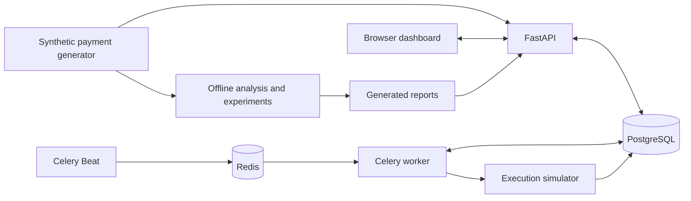

# PayRevive

PayRevive is a payment recovery simulator for INR subscription card payments. It
tracks failed payments, flags issuer and gateway degradation, diagnoses ambiguous
declines, and compares retry policies against a matched control. The dashboard
brings payment timelines, simulator approvals, and replay results into one place.

## Run the demo

Use Docker with Compose v2 and an available local port 8000.

```sh
git clone https://github.com/vridhichaudhary/PayRevive.git
cd PayRevive
cp .env.example .env
docker compose up --build --wait --wait-timeout 180
docker compose exec -T api python -m scripts.demo_seed
docker compose exec -T api python -m scripts.dashboard_smoke
```

Open the [dashboard](http://localhost:8000/) or [API reference](http://localhost:8000/docs).
The seed imports 65 synthetic payment histories with feature snapshots and creates
`dashboard-demo-approval` under the default recovery rules. Open that payment to
inspect its failure and recovery decision. Approve the simulator retry, then refresh
the timeline after the worker records the outcome. A simulated retry can succeed or fail.

The dashboard seed also generates detection and monetary reports. Load the optional
diagnosis report using the commands below. Repeating the seed reuses record identities
and preserves approval history. Set `API_PORT` in `.env` to change the browser port.
`docker compose down` preserves the database and report volumes.

## What it does

| Capability | Behavior |
| --- | --- |
| Payment ingestion | Tracks obligations, attempts, and observed events separately. Duplicate deliveries reuse the original records, and older observations stay in history without replacing newer state. |
| Recovery | Proposes retries from recorded decline reasons. Execution rechecks eligibility, including consent, cooldown, attempt budget, payment state, and any required operator approval. |
| Durable execution | Persists action state, audit events, and simulator receipts. The scheduler dispatches due work and the worker reconciles uncertain outcomes. |
| Degradation detection | Compares daily issuer and gateway decline rates against a fixed threshold and a rolling baseline. Incident truth is opened during replay evaluation. |
| Failure diagnosis | Uses a specific reported cause directly. Offline models compare majority, logistic regression, and random forest baselines for ambiguous failures, with abstention and probability-space SHAP explanations. |
| Monetary evaluation | Replays no intervention, fixed-delay retries, and reason-based retries with matched customer populations and shared settlement outcomes. Reports net incremental INR and paired bootstrap intervals. |

## Architecture



PostgreSQL owns payment state, execution schedules, feature provenance, and audit
history. Redis transports work. Alembic applies schema migrations during Compose startup.
The dashboard uses HTML, CSS, and JavaScript served by FastAPI. Training, evaluation,
and notebooks run in an optional analysis environment. The online recovery path uses
deterministic rules and recorded evidence.

## Measured results

| Evaluation | Synthetic result |
| --- | --- |
| Degradation | Both detectors caught all three injected incidents within 24 hours in each of two runs. The fixed threshold raised 3 false alerts across those runs compared with 16 for the rolling baseline. Both runs share the same incident schedule. |
| Diagnosis | The selected forest reached 0.307 macro F1 on the March test split. It diagnosed 244 of 471 ambiguous failures at 78.7% accuracy among accepted cases. Risk-block F1 was zero. |
| Recovery | Across 100 matched seeds, fixed 48-hour retry averaged ₹43,448.11 net incremental per 500-customer cohort, with a 95% interval of ₹41,464.47–₹45,451.16. Reason-based retry averaged ₹19,087.24. |

Net incremental recovery subtracts matched control settlement and retry costs.
When simulated payments became ready four times faster, the fixed schedule's advantage
over reason-based retry fell to ₹1.65 per cohort. The intervals describe variation across
simulation seeds under the specified assumptions. The dashboard seed uses a smaller run.

## Reproduce the analysis

Install Python 3.13 and uv. Each generator and report command requires a new output
directory. The generator uses versioned seeds and separates operational records from
hidden labels and injected incident intervals.

```sh
uv sync --frozen --group analysis
uv run --group analysis python -m simulator.run --config simulator/configs/baseline.json --output work/datasets/demo
uv run --group analysis python -m ml.analysis.degradation --dataset work/datasets/demo --output work/detection
uv run --group analysis python -m ml.analysis.diagnosis --dataset work/datasets/demo --output work/diagnosis
uv run --group analysis python -m experiments.report --output work/experiment
uv run --group analysis python -m experiments.report --config experiments/fast-readiness.json --output work/experiment-fast
```

Diagnosis fits on January, chooses the model and threshold on February, and evaluates
on March. For the independent seed and shifted calendar, generate an export with
`simulator/configs/detection-challenge.json` and pass its directory with `--challenge`
to the diagnosis command. For fresh-kernel HTML reports, see
[notebook commands](notebooks/README.md). The experiment exports per-seed results,
configuration, intervals, a comparison chart, and checksums.

Load the trusted local diagnosis JSON into the dashboard's report volume, then refresh:

```sh
docker compose exec -T api sh -c '
  dir="$PAYREVIVE_DEMO_REPORTS/diagnosis"
  mkdir -p "$dir" &&
  cat > "$dir/.pending" &&
  mv "$dir/.pending" "$dir/diagnosis.json"
' < work/diagnosis/diagnosis.json
```

To import a generated dataset with feature provenance, run
`uv run --group analysis python -m simulator.ingest work/datasets/demo --limit 50 --with-features`
while the API is running.

## Development and verification

```sh
uv sync --frozen --group analysis
uv run --group analysis ruff check .
uv run --group analysis pytest -q -W error
uv run --group analysis pytest -m analysis -q -W error
docker compose --profile test run --build --rm test-runner
docker compose exec -T api python scripts/recovery_smoke.py
```

[GitHub Actions](https://github.com/vridhichaudhary/PayRevive/actions) runs the unit
tests, real PostgreSQL integration tests, Docker startup and restart checks, recovery
smoke tests, and notebook execution. `/health/live` checks the process.
`/health/ready` checks PostgreSQL, the schema revision, and Redis.

| Directory | Contents |
| --- | --- |
| [backend/](backend/) | API, database migrations, event ingestion, recovery worker, dashboard, and integration tests |
| [simulator/](simulator/) | Seeded data generator and local API ingestion |
| [ml/](ml/) | Feature loading, degradation detection, diagnosis, evaluation, and SHAP |
| [notebooks/](notebooks/) | Executable audit, detection, and diagnosis notebooks |
| [experiments/](experiments/) | Paired policy replay and monetary reporting |
| [scripts/](scripts/) | Demo setup and end-to-end smoke checks |

## Scope

PayRevive uses synthetic INR data, simulated execution, and one local demo organization.
Production authentication, public deployment, and payment provider integration are
outside the current scope. The replay results describe the simulator scenarios.
