# Phase 3 — Safe rule-based recovery

Status: COMPLETE for local Phase 3 acceptance, verified 13 November 2026. Detection/ML and financial experiments are not implemented.

## Objective and separation of responsibilities

A recommendation answers “what might help?” Eligibility answers “may we do it now?” Execution
records what actually happened. None of these is interchangeable. This phase introduces
explicit online consent, versioned decision evidence, durable actions/approvals, scheduled
execution, a persistent simulator receipt ledger, reconciliation, and at-least-once delivery.
It still never calls a real payment provider or moves real money.

```mermaid
flowchart LR
    E[Failed payment event] --> O[Transactional outbox]
    O --> D[Rule recommendation]
    D --> C[Independent eligibility]
    C --> A[Approval or scheduled action in PostgreSQL]
    A --> G[Execution-time recheck and claim]
    G --> S[Simulator operation ledger]
    S --> R[Receipt reconciliation]
    R --> F[Atomic outcome, attempt, event and audit]
```



The action ledger and PostgreSQL due times are authoritative. Redis carries disposable work
notifications. Celery Beat runs one five-second sweep schedule, and workers perform the work.
The beat health check establishes process liveness; the recovery smoke test proves useful
end-to-end scheduling/execution. Run one Beat instance; duplicate sweeps remain safe but add load.

## Defaults are simulation policies

| Rule | Initial value |
| --- | --- |
| Maximum total attempts, including original | 3 |
| Minimum cooldown | 6 hours |
| Insufficient-funds delay | 24 hours |
| Issuer/gateway transient delay | 6 hours |
| Recovery age window from first observation | 7 days |
| Human approval threshold | INR 1,000 and above |
| Nominal cost per executed simulator operation | 25 paise |
| Conservative expected success for economics | 25% funds, 50% transient |

These values are configurable business/simulation assumptions, not provider rules, network
restrictions, law, measured customer behavior, or trained-model predictions. Economics uses
exact basis-point arithmetic: `amount_minor * success_bps > cost_minor * 10000`. A positive
estimate does not prove that an actual intervention will be profitable.

The eligibility algorithm has an explicit `sim-v2` version prefix as well as a configuration
hash, so logic changes can invalidate old approvals. Rules load through the existing typed settings (`PAYREVIVE_RECOVERY_RULES` accepts a JSON
object) and have a content-derived version. Configuration changes require restarting the app,
worker, and scheduler with the same configuration. Every decision stores its exact rule
snapshot/version. There is no policy-editing UI or per-tenant policy registry yet.

Known funds/transient reasons propose retries. An expired method proposes an update request,
risk evidence proposes no action, and missing/unknown reasons propose review. Update/review
are informational proposals: no message is sent and no automatic retry is attached.
The eligibility engine can veto a retry independently of any future model recommendation.
It verifies reason, cost, probability assumption, and reason-specific minimum delay against
recorded evidence and trusted rules; it never accepts the proposer's own claimed authority.
Any recorded expired-method or risk evidence conservatively blocks retries for this payment;
method replacement/unblocking workflows are not implemented.

## Consent and compatibility

Phase 1 payments had no linked online customer. Those records remain valid historical data,
but are ineligible for recovery. Phase 2's offline customer/card files do not establish consent.
This phase adds an online customer reference and explicit `retry_consent`, defaulting to false.

Payments can optionally link a customer at creation. Organization IDs participate in the
foreign key, so cross-organization links fail. Customer identity on a payment is immutable
through the API. Replaying customer creation returns current preferences and never re-enables
previously revoked consent; changing preferences requires the explicit consent endpoint.

Consent updates lock the customer, then their payments in stable order. A revisioned,
append-only preference history is stored. Opt-out immediately cancels scheduled and
awaiting-approval actions. It does not erase in-flight/unknown operations. Reconciliation
still records an existing receipt after opt-out, but cannot authorize a new absent operation.
This is operator-supplied simulation consent, not a verified real customer authorization.

## Durable state machine

```text
awaiting_approval --> scheduled --> executing --> succeeded / failed
       |                 |             |
       +--> cancelled <--+             +--> unknown --> reconciliation
                         |
                         +--> superseded (paid, stale evidence, changed policy)
```

`unknown` remains active and blocks another recovery action for the payment. A PostgreSQL
partial unique index permits only one active action per payment, including awaiting approval,
scheduled, executing, and unknown states. A financial attempt number is reserved on the action
at claim, but an attempt row is created only once a processor receipt is known. Transport
retries therefore cannot manufacture extra financial attempts or costs.

Recommendations are idempotent for the same relevant context. Concurrent callers receive the
same active action. The decision stores failure evidence, rule version, proposal, and eligibility
at recommendation time. That stored eligibility is historical evidence, not a reusable permit.
An approval binds to the same evidence, rule version, and customer revision. Execution rechecks
all of them as well as consent, terminal evidence, current status, caps, economics, age, and time.
Stale work is superseded/cancelled; a fresh recommendation is needed after new relevant evidence.
A confirmed failed retry can generate another future recommendation within the remaining cap;
its cooldown prevents an immediate execution loop.

Current approvals use the literal actor label `local_operator`. Authentication/RBAC is still
absent, so this is an inspectable simulation workflow, not a trusted production approval system.
The service remains bound to loopback.

## Claim, call, finalize: the failure boundary

1. **Claim transaction:** lock customer, payment, then action; validate current eligibility;
   reserve a fixed attempt number and a 60-second lease; record the claim and commit.
2. **Simulator call:** use the action UUID as a stable operation key. A separate transaction
   records a receipt in `simulator_operations`. No application payment row lock is held across
   this call. The local simulator locks the action authorization while creating its receipt.
3. **Finalize transaction:** verify the bound request/amount/cost/status/time; record exactly
   one attempt/event/outcome/outbox message and audit entry; update current state and action.

The simulator ledger shares the PostgreSQL server but uses a separate transaction. This models
the split-commit failure boundary without pretending to be an independent real processor.
A future sandbox must implement verified provider idempotency/reconciliation semantics.

A timeout is never recorded as a decline. It changes the action to unknown. If a worker dies
after claim, its lease and operation key survive. If it dies after processor commit, the receipt
survives. Reconciliation reads that receipt and completes the missing application transaction.
Receipt storage is append-only and retries with changed request details return a conflict.

Only this local simulator can authoritatively establish absence of an operation. Before
resuming an absent operation, recovery reacquires the locks, checks the local ledger again,
and rechecks eligibility. This avoids cancelling an already committed operation after a stale
absence lookup. If absence is not authoritative, no resubmission occurs. Unknown work uses
bounded exponential backoff; after five reconciliation/failure steps it requires review and
remains active. A later known receipt can still be recorded without dispatching another charge.

A lease expiry alone does not prove that an external charge failed. Idempotency and receipt
lookup provide correctness; the lease only makes abandoned work eligible for inspection.

**Dispatch boundary:** opt-out before claim prevents dispatch. An operation already authorized
and dispatched cannot be retroactively cancelled by changing preferences. The system must
reconcile and report its actual result. This project does not implement reversals/refunds.

## Outbox delivery and worker reliability

The outbox now tracks `published_at` and `processed_at` separately. A publisher uses
`FOR UPDATE SKIP LOCKED`; failed broker publication rolls back its timestamp. Unprocessed
messages are republished after 30 seconds, covering lost queue notifications and consumer
crashes. Consumers perform idempotent work before recording processing completion.

The sweep also finds due actions and expired/unknown operations directly in PostgreSQL.
Queue redelivery cannot claim the same action twice. Recovery tasks use late acknowledgement,
worker-loss rejection, and bounded retry/backoff. Broker delivery is still at least once;
the stable processor key and database constraints provide idempotent application effects.

During Redis loss, PostgreSQL ingestion can still commit even though readiness returns 503.
Once Redis returns, pending work is rediscovered and processed. Readiness is a routing signal,
not a substitute for operation-specific eligibility checks.

## APIs and files

All paths begin `/v1/organizations/{org_id}`.

| Endpoint | Purpose |
| --- | --- |
| POST /customers | Create a synthetic online customer; consent false by default |
| GET /customers/{id} | Read preferences and revision history |
| PUT /customers/{id}/consent | Explicit preference change and pending-action cancellation |
| GET /recovery/policy | Inspect current simulation assumptions and version |
| POST /payments/{id}/recommend | Persist recommendation and eligibility; schedule if allowed |
| GET /recovery/actions | Latest actions, bounded to 100 per request |
| GET /recovery/actions/{id} | Current action state |
| POST /recovery/actions/{id}/approve | Bind local approval; does not execute directly |
| POST /recovery/actions/{id}/execute | Recheck and execute a due scheduled action |
| POST /recovery/actions/{id}/reconcile | Resolve an unknown/in-flight operation safely |
| POST /recovery/actions/{id}/cancel | Cancel undispatched work; unresolved dispatches return 409 |

Payment detail includes `recovery_decisions`, `recovery_actions`, and `recovery_outcomes`.
Public ingestion cannot use reserved receipt source IDs or the recovery account. It also
rejects attempt numbers reserved by unresolved recovery operations. Success remains absorbing.
Legacy payment creation stays compatible; the optional `customer_id` field defaults to null.

New tables: online customers, preference history, recovery decisions, actions, simulator
operations, and outcomes. Decisions, preferences, receipts, and outcomes reject ordinary
updates/deletes/truncation. Migration `0003_recovery` upgrades the prior domain without
rewriting old migrations. Existing outbox records remain eligible for processing.

- `decision/policy.py`: pure proposals and validated versioned simulation rules.
- `compliance/engine.py`: independent deterministic gate, exact economics, no network calls.
- `recovery/context.py`: lock order and authoritative eligibility context.
- `recovery/customers.py`: scoped customer registration, consent revisions, cancellation.
- `recovery/planning.py`: idempotent recommendations with immutable snapshots.
- `recovery/execution.py`: claims, approvals, unknown state, reconciliation, atomic finalization.
- `execution/simulator.py`: persistent idempotent receipt ledger; no provider client exists.
- `recovery/dispatch.py`, `tasks.py`: durable discovery, outbox delivery and Celery adapters.
- `recovery/routes.py`: thin HTTP adapters for the above business services.
- Tests, recovery smoke, Compose scheduler and CI: real behavior and failure verification.

## Run and inspect

```sh
docker compose up --build --wait --wait-timeout 180
docker compose exec -T api python scripts/recovery_smoke.py
```

This smoke test prints payment IDs. Open http://127.0.0.1:8000/docs and GET those payments:
there is a manual-approval case, a cancelled case, and a scheduler/worker-only case. No UI
is implemented yet. The autonomous case requires no recommend/execute HTTP call.

For a manual walkthrough, create an online customer with `retry_consent: true`, then create
an INR payment linked by `customer_id`. Use an amount of 149900 for the approval case. Add
an `issuer_unavailable` failure with attempt number 1 and a timestamp 30 hours ago. Generate
a suitable timestamp using:

```sh
uv run python -c 'from datetime import UTC,datetime,timedelta; print((datetime.now(UTC)-timedelta(hours=30)).isoformat())'
```

Request a recommendation. Its action awaits approval. Calling execute cannot bypass that
state. Approve it, then execute or allow the scheduler to dispatch it. Read the complete
payment timeline. Opting out a customer with pending work cancels it. Historical January
dataset records remain ineligible by default and are outside the seven-day recovery window.

## Verification and limitations

```sh
uv run pytest -q -W error
docker compose --profile test run --build --rm test-runner
docker compose exec -T api python scripts/smoke.py
docker compose exec -T api python scripts/simulator_smoke.py
docker compose exec -T api python scripts/recovery_smoke.py
```

Crash tests inject interruption at committed PostgreSQL boundaries, including SystemExit
after simulator commit. They do not claim that every OS, network partition, or sandbox failure
has been reproduced. Scheduler/worker behavior and a real Redis outage/recovery are verified
separately. The isolated PostgreSQL test database never uses the demo database.

Gross recovered amount and operation cost are bookkeeping only. If a payment was already
marked successful before receipt finalization, another successful receipt is not counted as
additional recovered value. No incremental attribution, revenue-lift claim, policy comparison,
confidence interval, ML diagnosis, SHAP, or provider compliance is implemented in this phase.
Simulator success probabilities are separate stylized assumptions (35% funds, 65% transient),
keyed by operation ID. They are not a valid experiment engine: Phase 5 must introduce matched
exogenous scenarios, reproducible experiment seeds, monetary controls, and uncertainty intervals.

Customer/card feature snapshots remain mostly offline. Durable feature ingestion/provenance
must precede online ML diagnosis. Policy configuration is deployment-wide, not per-tenant;
all business records and worker payloads retain organization ownership, but authentication,
RBAC, least-privilege database roles, policy UI, external provider signing, message delivery,
and production deployment are deferred.

## Acceptance results

| Check | Actual result |
| --- | --- |
| Unit tests, warnings treated as errors | 72 passed, final run 5.76 seconds |
| Real PostgreSQL integration tests | 56 passed, final run 1.67 seconds |
| Tampered reason/cost/probability/due time | Rejected independently of the proposer |
| Six concurrent executions and replay | One operation, one outcome, one new attempt |
| Different active actions for one payment | Database partial unique index rejects the second |
| Cross-organization customers/actions | Scoped 404 responses and composite-FK rejection |
| Approval, cooldown, limits, age, economics | Tested vetoes and execution-time rechecks |
| Missing eligibility rules | No processor call; pending work remains unexecuted |
| Opt-out before dispatch | Scheduled work cancelled; replay cannot restore consent |
| Success/stale evidence/policy changes | Work superseded or cancelled before dispatch |
| Timeout before/after processor commit | Unknown, then same-key reconciliation; no new attempt allocation |
| Crash after claim | Lease-gated recovery with original operation identity |
| Crash after processor commit | Receipt recovered without resubmission |
| Outcome-store failure | Attempt/event/outcome rollback; durable receipt retained |
| Conflicting/stale receipt lookup | No incorrect projection or lost committed outcome |
| Non-authoritative absence | No resubmission; bounded escalation to review |
| Unknown after opt-out | Existing receipts recorded; absent operations not retried |
| Two outbox dispatchers | SKIP LOCKED prevents duplicate concurrent publication |
| Failed broker publication | Publication state rolled back; unprocessed work republished |
| Real Redis outage/restart | Durable event survived; exactly one recovery outcome afterward |
| Fresh and existing schema migration | Successful through 0003_recovery; repeated upgrade passed |
| Migrated schema versus metadata | No differences |
| Rebuilt five-service stack | API, PostgreSQL, Redis, worker, scheduler healthy |
| Real API recovery smoke | Approval, replay, cancellation, autonomous worker recovery passed |
| Retained-volume restart | Prior operation outcome/history preserved; all smoke checks passed |
| Ruff lint/format, frozen dependencies, Compose config, whitespace | Passed; 60 Python files formatted |

The phase deliberately distinguishes locally injected crash-boundary tests from actual OS
process kills. Redis outage and container restart were exercised against real services.
No local acceptance failures remain. Core policy milestone `56ae911` was committed/pushed
separately; the integrated milestone is published after these checks, and its hosted CI
result is verified during delivery rather than assumed in this record.

The final smoke printed these local demonstration payment IDs:

- Manual approval: `cfb52b3f-efd5-4aee-abbf-05ab7901c322`.
- Opt-out cancellation: `117198e1-ce77-4387-983c-43a938510f53`.
- Autonomous scheduler/worker case: `abe3f271-fef0-4e12-8f31-9fe97a753a3e`.

Use the demo organization and GET payment detail to inspect them. Outcomes are simulated;
failed retries may have a future scheduled recommendation, subject to cooldown and attempt cap.

## Interview questions

- Why not execute inside the database transaction? An external request cannot roll back with
  SQL; holding locks across it adds contention without solving split-commit ambiguity.
- Why must unknown block a new action? A timed-out request might already have succeeded.
- Why recheck consent and approvals? Scheduling and execution happen at different times;
  the evidence or permission may have changed.
- Why are receipt recording and new execution different? Recording a past fact must continue
  after opt-out; permission is required for a new operation, not for acknowledging reality.
- Why is a lease insufficient? A slow worker can outlive a lease; only stable operation identity
  and reconciliation prevent duplicate financial effects.
- Why separate publication from processing? Broker acceptance does not prove business work
  completed; redelivery and idempotent consumers close that gap.

Next: degradation detection, failure diagnosis, temporal evaluation, and SHAP. These remain
core MVP requirements. The upcoming plan must first address online feature provenance.
